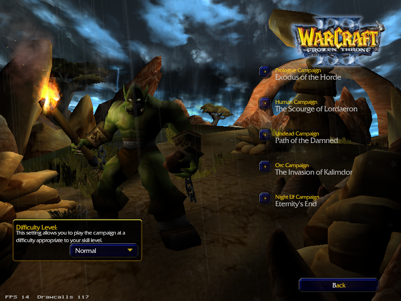
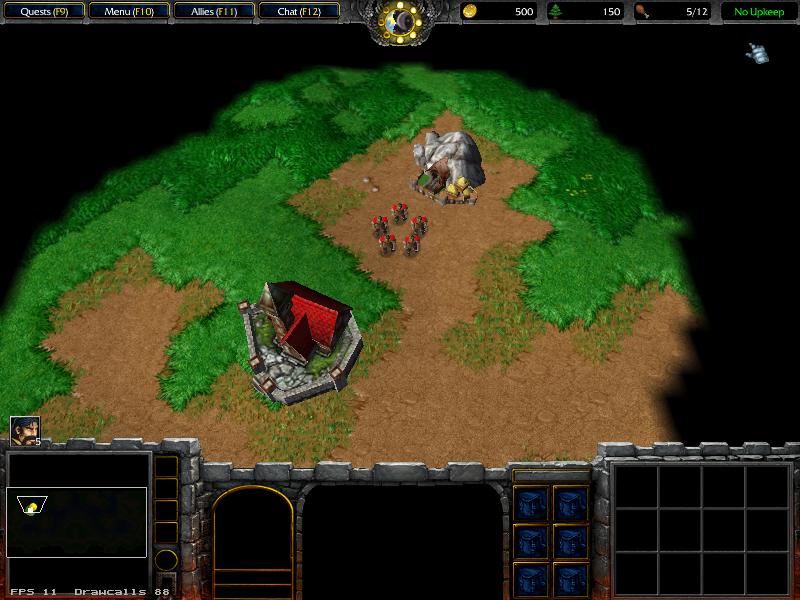

# wc3-wasm

**Warcraft III in the browser** — a WebAssembly + WebSocket port of the [OpenRealm](https://github.com/corepunch/open-realm) Warcraft III engine, running the full game client — menus, melee, the complete Reign of Chaos + The Frozen Throne campaigns, cinematics, audio, and multiplayer — in a browser tab. Status as of **2026-10-18**, verified on a live deployment (headless and real-GPU hardware).



*The campaign select screen live in the browser — all 9 RoC + TFT campaigns with real backdrops. Warcraft III content © Blizzard Entertainment, Inc. — captured from a privately owned install.*



*Classic melee map (Booty Bay), rendered by the ported engine at 1280×720 in the browser. Content © Blizzard Entertainment, Inc.*

## ⚠️ You bring the game

This repository contains **no Warcraft III content** — no game data, no Blizzard assets, in the git history, the working tree, or any release. To play, you supply **your own legally obtained copy** (an installation made through your own Battle.net account, i.e. the Reforged-era client with the classic data). `scripts/prepare-data.sh` extracts the data tree from *your* installation into a directory you serve locally — nothing is re-hosted or redistributed here. Read [NOTICE.md](NOTICE.md) before you start.

## What works

| Area | State |
| --- | --- |
| Engine boot | ✅ Full client boot in the browser: Blizzard → War3 logo FMVs, main menu (both RoC and TFT editions), options, LAN/multiplayer screens, exit. |
| Melee / skirmish | ✅ Classic and Frozen Throne melee maps play: terrain, units, pathfinding, combat, HUD. A 568-entry map catalog (312 built-in + 256 community maps) is seeded into the in-game map browser; opening any listed map fetches its archive on demand. |
| Campaigns | ✅ All 9 campaigns play their missions: terrain, units, triggers, quests, victory/defeat, mission chains — the full RoC run plus the TFT campaigns, including their closing model cinematics. |
| Dialogue & cinematics | ✅ Mission transmissions display with the correct localized speaker/text for each voice-over line (verified line-by-line in live runs); pre-rendered FMVs play through a full-screen overlay; in-engine model cinematics render in-world. |
| Audio | ✅ The Reforged SD data ships FLAC audio; the client decodes it natively (vendored `dr_flac`) and plays music, unit responses and campaign voice-over through the browser's audio pipeline. |
| Multiplayer | ✅ Browser clients join a native dedicated server through a WebSocket ⇄ UDP bridge: lobby creation from the browser, slots, in-browser LAN discovery/join, match start by the lobby host. Verified with real two-client sessions on the public deployment. |
| Mobile | ✅ Portrait/landscape responsive canvas; touch layer (tap select, long-press command, drag pan, pinch zoom) and gamepad layer (any OS-paired Bluetooth/USB pad) synthesized into engine input. |
| Modding surface | ✅ JASS coverage completed for campaign content (70 previously-missing natives implemented with real behavior where the data supports it); protected ("Spazzler"-style) custom maps open correctly — `war3map.w3i` extraction is byte-identical to StormLib on a protected test map. |
| Persistence | ✅ Campaign progress is stored browser-side and honored across reloads (verified with a crafted save: unlock gating reflects the restored file). |
| Display | ✅ Engine canvas adapts to the viewport (100vw/100dvh) — desktop and phone; build-id negotiation keeps wasm/data URLs cache-safe. |

Notes: ~50 mission-referenced sound files are genuinely absent from the SD data set and are skipped gracefully; the FMV overlay expects your own transcodes in `web/movies/` (see `docs/data-prep.md`) and continues if absent; on headless software-WebGL stacks (CI) fog-of-war can render black — a `?fow=off` query switch exists for diagnostics; real-GPU browsers render correctly (verified 2026-10-18).

## Try it

Prerequisites: git, docker, cmake, g++, python3, node (for the bridge).

```bash
# 1. engine: pinned upstream + this port's patch series
scripts/setup-sources.sh              # → ./open-realm (29 patches applied)

# 2. build the wasm client
scripts/build-wasm.sh                 # → open-realm/build/em-web/bin/openwarcraft3.{js,wasm,data}

# 3. extract data from YOUR install (never downloaded or redistributed here)
scripts/prepare-data.sh "/path/to/your/Warcraft III"   # → ./data-www (served mirror)

# 4. serve
cp open-realm/build/em-web/bin/openwarcraft3.* web/
python3 scripts/serve.py              # → http://127.0.0.1:8080/
```

### Prebuilt client (v0.1.0)

Grab `wc3-web-v0.1.0.tar.gz` from the [releases page](../../releases). Extract it
into a directory, place your extracted `gamedata/` mirror next to `index.html`
(see [docs/data-prep.md](docs/data-prep.md)), then:

```bash
python3 serve.py --web . --data ./gamedata
# → http://127.0.0.1:8080/
```

### Multiplayer

```bash
scripts/build-native.sh               # native engine for the dedicated server

# dedicated lobby (Browser-host flow; client page connects via ?ws=)
docker run -d --name wc3-dedicated --network=host \
  -v "$PWD":/w -e WC3_DATA=/w/data-www -w /w/open-realm \
  ghcr.io/corepunch/open-realm-ci:ubuntu-24.04 \
  bash /w/tools/ws-bridge/run-dedicated-custom.sh

# WebSocket ⇄ UDP bridge (one browser connection = one ephemeral UDP socket)
cd tools/ws-bridge && npm install && cd ../..
node tools/ws-bridge/bridge.mjs --listen 8790 --target 127.0.0.1:27960

# open  http://127.0.0.1:8080/?ws=ws://127.0.0.1:8790
```

In deployments where the client is served with a `/ws` route behind TLS, no query parameter is needed — the page derives `wss://<host><path>/ws` automatically.

## Repository layout

```
patches/              29-patch series over corepunch/open-realm @ e478da81
web/                  browser shell (index.html, wc3-input.js) — drop the built bins in
scripts/              setup-sources / build-wasm / build-native / prepare-data / make-mirror / serve
tools/casc-extract/   CASC extractor (CascLib-based) + the SD data name list
tools/ws-bridge/      WebSocket ⇄ UDP bridge + dedicated-server run scripts + console fixtures
tools/gen-campaign-strings.py   CampaignStrings generator (Reforged data -> classic schema)
docs/                 CHANGELOG (full timeline), architecture, data prep, data formats
```

## Changelog

Every fix, feature and milestone — with dates and commit hashes — is in **[docs/CHANGELOG.md](docs/CHANGELOG.md)**.

## Legal

Original code here is MIT (see [LICENSE](LICENSE)); the engine patches apply to the MIT-licensed upstream tree. Warcraft III, its data and screenshots of it are © Blizzard Entertainment, Inc.; no rights are granted over any of it. You must own the game to use this. Details: [NOTICE.md](NOTICE.md).
